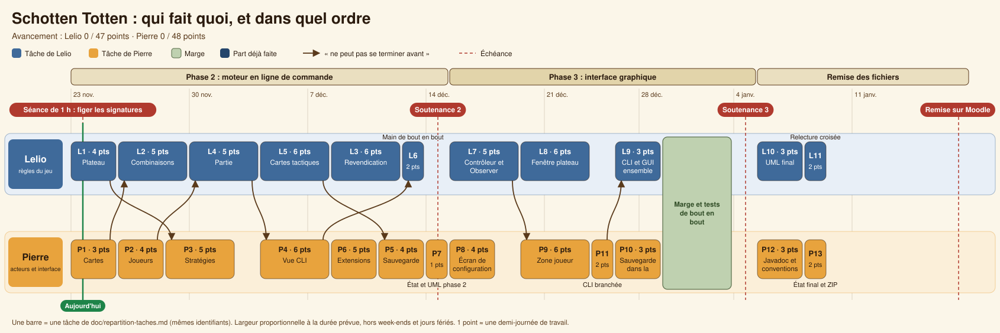

# Répartition des tâches

Voici la répartition que je propose pour Pierre et moi. L'unité est le point : 1 point correspond
à peu près à une demi-journée de travail. Ce sont des estimations, à revoir ensemble à chaque
jalon. Chaque tâche inclut ses tests unitaires et sa Javadoc.

Nous ne sommes pas indépendants : chacun possède ses packages, mais certaines tâches ne peuvent
pas se terminer avant une tâche de l'autre. La colonne « Dépend de » les indique, et le schéma
ci-dessous les montre en flèches.

Le schéma est généré par `progression/progression.mjs`. Pour mettre l'avancement à jour, on
modifie les pourcentages en tête de ce script, on lance `node doc/progression/progression.mjs`
et on committe le SVG avec le reste.

## Phase 2 : moteur en ligne de commande (soutenance du 14 décembre)

**Lelio : règles du jeu (28 points)**

| Id | Tâche | Pts | Dépend de |
|---|---|---|---|
| L1 | Borne, Pioche, Défausse | 4 | squelette des cartes (séance du premier jour) |
| L2 | Combinaisons et départage | 5 | P1 |
| L4 | `Partie` (Singleton), tours, fin de partie | 5 | L1, P2 |
| L5 | Cartes `ModeCombat` et `Ruse`, variante tactique | 6 | L4, P1 |
| L3 | Revendication, y compris la preuve d'imbattabilité | 6 | L1, L2 |
| L6 | `Main` et partie complète de bout en bout | 2 | L4, P3, P4 |

**Pierre : acteurs et interface (28 points)**

| Id | Tâche | Pts | Dépend de |
|---|---|---|---|
| P1 | Hiérarchie `Carte`, `CarteClan`, `CarteTactique` (abstraite), `Couleur`, `TroupeElite` | 3 | squelette poussé à la séance du premier jour |
| P2 | `Joueur`, `JoueurPhysique`, `JoueurVirtuel` | 4 | P1 |
| P3 | Stratégies défensive et offensive | 5 | L1, P2 |
| P4 | Vue CLI : menu, affichage, saisie | 6 | L4 |
| P6 | Extensions : conception, implémentation, choix au démarrage | 5 | P1, L4 |
| P5 | Sauvegarde et chargement | 4 | L5, P6 |
| P7 | `doc/current-state.md` et UML de la phase 2 | 1 | |

## Phase 3 : interface graphique Swing (soutenance du 4 janvier)

**Lelio (14 points)**

| Id | Tâche | Pts | Dépend de |
|---|---|---|---|
| L7 | Contrôleur et Observer (modèle vers vues) | 5 | L4 |
| L8 | Fenêtre principale : bornes, cartes posées, revendication | 6 | L7 |
| L9 | CLI et GUI dans la même partie (synchronisation, thread Swing) | 3 | L8, P11 |

**Pierre (15 points)**

| Id | Tâche | Pts | Dépend de |
|---|---|---|---|
| P8 | Écran de configuration : joueurs, stratégies, extensions, variantes | 4 | interface du contrôleur (séance de début de phase) |
| P9 | Zone joueur : main, sélection carte/borne, pioche, défausse, tactiques | 6 | L7 |
| P11 | Branchement de la CLI sur le contrôleur et l'Observer | 2 | L7 |
| P10 | Sauvegarde et chargement depuis la GUI, erreurs, fin de partie | 3 | P5, P9 |

## Remise (vendredi 15 janvier)

| Id | Qui | Tâche | Pts | Dépend de |
|---|---|---|---|---|
| L10 | Lelio | Diagramme de classes final et justification des changements entre la version initiale et la version finale | 3 | code figé |
| L11 | Lelio | Relecture croisée du code de Pierre | 2 | L10 |
| P12 | Pierre | Relecture de la Javadoc et des conventions (Checkstyle) | 3 | code figé |
| P13 | Pierre | État final de l'application et archive ZIP | 2 | P12 |

**Total sur le projet : Lelio 47 points, Pierre 48 points.**

## Ordre de livraison de la première semaine

Le chemin critique passe par les premières livraisons de Pierre : tant que la hiérarchie des
cartes n'est pas fusionnée, mes combinaisons ne peuvent pas être branchées sur les vraies classes.

1. **Lundi 23 novembre, séance d'une heure.** On fige les signatures publiques de `Carte`,
   `CarteClan`, `CarteTactique`, `Couleur`, `Borne`, `Joueur`, `Strategie` et `Partie`. À la fin
   de la séance, Pierre pousse un squelette : les signatures des classes de cartes, corps vides.
   Je commence L1 contre ce squelette.
2. **Mardi 24.** Pierre fusionne P1 complet (les vraies cartes). Je termine L1 et je passe à L2.
3. **Mercredi 25 et jeudi 26.** Pierre fusionne P2 (`Joueur`), ce qui débloque ma tâche L4
   (`Partie`). Je travaille sur L2 en attendant.
4. **Vendredi 27.** Pierre démarre P3 (stratégies) : L1 est terminé, il peut s'appuyer sur la
   vraie `Borne`.
5. **Lundi 30 novembre et mardi 1er décembre.** Je termine `Partie` (L4) : elle débloque sa CLI
   (P4) dès le mercredi 2 décembre, puis ses extensions (P6).

## Dates à tenir

Je vise un travail entièrement terminé le vendredi qui précède chaque soutenance, pour garder le
week-end et le début de semaine pour répéter et corriger :

- **Phase 2 : vendredi 11 décembre** (soutenance la semaine du 14). Mes tâches finissent le
  jeudi 10, celles de Pierre le vendredi 11, jour où il met à jour l'état de l'application et
  l'UML (P7).
- **Phase 3 : jeudi 31 décembre**, puisque le vendredi 1er janvier est férié (soutenance la
  semaine du 4 janvier). Les trois derniers jours sont une marge pour les tests de bout en bout.
- **Remise : vendredi 15 janvier**, avec une semaine de réserve après la relecture.

Pour tenir le 11 décembre, ma tâche L4 est comptée sur 2 jours et les tâches P6 et P5 de Pierre
sur 2 jours chacune, un peu en dessous de leurs points. Je garde le vendredi 11 en réserve, Pierre
n'a aucune marge : on regarde ça au premier jalon.

En phase 3, on refait une séance de 30 minutes dès le lundi 15 décembre pour figer l'interface du
contrôleur : Pierre peut ainsi commencer l'écran de configuration (P8) sans attendre mon
implémentation (L7).

## Logique de construction

J'ai découpé par **blocs de packages**, pas par type de tâche. Chacun garde un bloc cohérent de
bout en bout : le code, ses tests et sa Javadoc. Ce choix évite que l'un écrive tout le code
pendant que l'autre ne fait que de la documentation, et il limite les conflits Git, puisqu'un
package n'a qu'un seul propriétaire.

Les deux blocs sont regroupés par thème :

- **Moi : les règles du jeu.** Plateau, combinaisons, revendication, déroulement de la partie,
  puis en phase 3 le contrôleur et la fenêtre du plateau. C'est la partie algorithmique, celle qui
  porte les choix de conception.
- **Pierre : les acteurs et ce qui touche l'utilisateur.** Cartes, joueurs, stratégies, CLI,
  sauvegarde, extensions, puis en phase 3 l'écran de configuration et la zone du joueur. C'est la
  partie la plus large.

L'équilibre n'est pas une égalité forcée sur le total. J'ai estimé chaque tâche, vérifié
l'équilibre phase par phase, puis déplacé quelques tâches vers le côté le plus léger : les
extensions, la sauvegarde, le branchement de la CLI et les documents de phase sont chez Pierre
pour compenser le côté « règles ». Le résultat est 28 contre 28 en phase 2, 14 contre 15 en
phase 3 et 5 contre 5 pour la remise.

Le découpage par blocs a un coût : les deux blocs s'appuient l'un sur l'autre. C'est pour cela
que l'ordre des tâches dans le schéma n'est pas celui des tableaux. Dans chaque couloir, j'ai
placé en premier ce qui débloque l'autre : les cartes et les joueurs de Pierre, puis mon plateau
et ma `Partie`, avant les revendications et les cartes tactiques qui ne bloquent personne.

Ces points restent des estimations, pas des mesures. Le côté « règles » est le plus difficile à
estimer, notamment la preuve d'imbattabilité de la revendication. Le calendrier suppose qu'un
point vaut une demi-journée de travail effectif : si nous avons moins de temps, on décale tout le
planning plutôt que de rogner sur les tests. Si l'écart se creuse, on rééquilibre à chaque jalon
en échangeant des tâches plutôt qu'en laissant l'un dépasser l'autre.
